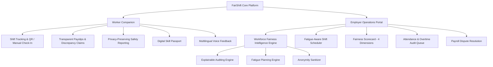

# FairShift — SDG 8 Workforce Fairness Platform

[](https://sdgs.un.org/goals/goal8)
[](https://srmist.edu.in)
[](https://nextjs.org/)
[](tests/)

**FairShift** is an accessible, production-minded workforce fairness platform designed for employee-intensive organizations transitioning away from paper registers, spreadsheets, and informal chat applications. It targets critical labor vulnerabilities: **unrecorded overtime, fear of reporting hazards, fatigue from consecutive shifts, lost training credentials, and lack of employer visibility**.

Built for **Prompt Wars 2026 × SRM ACM Student Chapter**, aligning directly with **UN Sustainable Development Goal 8 (Decent Work & Economic Growth)**.

---

## 1. Quick Start & Running Locally

### Prerequisites
- Node.js `v20+` or `v22+`
- npm `v10+`

### Installation & Launch
```bash
# Clone the repository and navigate into the workspace
git clone https://github.com/your-org/FairShift.git
cd FairShift

# Install dependencies
npm install

# Run automated test suite (Vitest)
npm test

# Launch the development server
npm run dev
```

Open [http://localhost:3000](http://localhost:3000) in your browser. The platform boots immediately into **Stateful Realistic Demo Mode** with zero external dependencies required.

---

## 2. Competitive Evaluation Criteria Mapping

| Evaluation Parameter | FairShift Implementation | Verification Reference |
| :--- | :--- | :--- |
| **1. Code Quality** | Strict TypeScript domain models, separated intelligence algorithms, deterministic math, reusable components. | [`src/types/index.ts`](src/types/index.ts), [`src/lib/calculations/`](src/lib/calculations/) |
| **2. Security** | Multi-tenant RLS isolation policies, cryptographic anonymity shielding, no leaked secrets or service-role keys. | [`supabase/migrations/001_initial_schema.sql`](supabase/migrations/001_initial_schema.sql), [`src/lib/intelligence/anonymity.ts`](src/lib/intelligence/anonymity.ts) |
| **3. Efficiency** | Zero redundant network waterfalls, indexed relational foreign keys, localized client-side caching with LocalStorage persistence. | [`src/lib/data/store.tsx`](src/lib/data/store.tsx) |
| **4. Testing** | Automated test suite covering overtime calculation, overnight shifts, duplicate check-in rejection, fatigue alerts, and cross-org isolation. | `npm test` runs 15 tests across 5 test suites. |
| **5. Accessibility** | Full English, Tamil (தமிழ்), and Hindi (हिन्दी) interface translations, large touch targets, Web Speech API voice reporting with fallback. | [`src/lib/i18n/translations.ts`](src/lib/i18n/translations.ts) |
| **6. Problem Alignment** | Demonstrates two distinct industries (Construction & University Facilities) under unified schema and configurable rules. | [`src/lib/data/seedData.ts`](src/lib/data/seedData.ts) |

---

## 3. Product Architecture

FairShift provides **two synchronized interfaces** sharing a unified state:



### A. Worker Companion (Mobile-First)
- **Home**: Live shift timer, large check-in button, site PPE checklist, real-time earned pay estimate.
- **My Shifts**: Weekly schedule, site locations, supervisor notes.
- **Attendance**: Verified check-in method logs, overtime records, missing check-out correction flow.
- **My Pay**: Transparent breakdown showing base hours, overtime hours with industry multiplier (1.5x / 2.0x), EPF/ESI statutory deductions, and interactive discrepancy submission.
- **Safety Reporting**: Hazard category selector, severity toggle, **Anonymous Identity Shielding**, and **Web Speech API Voice Recording** in English, Tamil, and Hindi.
- **Skill Passport**: Worker-owned certificates from NSDC, L&T CSTI, Diversey, and THSC with verification stamps.

### B. Employer & Compliance Portal (Desktop / Tablet)
- **Overview**: Real-time KPI counters (Workforce, Present %, Overtime Exceptions, Unresolved Hazards, Fairness Score).
- **Shift Management & Fatigue-Aware Scheduler**: Schedule shifts with real-time pre-assignment fatigue checks.
- **Attendance Audit**: Exceptions queue (missing check-outs, abnormal overtime, late arrivals).
- **Payroll Review**: Deterministic calculation audit and dispute resolution queue with supplementary payouts.
- **Safety Reports**: Kanban and incident tracker with zero identity disclosure on anonymous tickets.
- **Fatigue Alerts**: Explainable rule engine flagging &lt;11h rest, &gt;10h shift duration, and &gt;48h weekly hours.
- **Fairness Scorecard (Main Differentiator)**: Audits Pay Transparency, Workload Fairness, Safety Responsiveness, and Worker Voice.

---

## 4. Workforce Fairness Intelligence Subsystems

### A. Explainable Pay and Workload Auditing
Derives discrepancies by mathematically auditing attendance logs against scheduled shifts and payroll runs:
- Rule `AUD-01`: Flags unclosed attendance sessions without checkout.
- Rule `AUD-02`: Compares verified overtime hours against credited hours on payslips.

### B. Fatigue-Aware Shift Planning
Evaluates shifts against occupational safety and labor standards (ILO Convention 106 & The Factories Act 1948):
- Rule `FS-R01`: Continuous shift duration &gt; 10 hours.
- Rule `FS-R02`: Inter-shift rest interval &lt; 11 hours.
- Rule `FS-R03`: Trailing 7-day cumulative workload &gt; 48 hours.

### C. Privacy-Preserving Safety Reporting
- Generates cryptographically pseudonymous tracking tokens (`ANON-XXXX-XXXX`).
- Sanitizes API responses and manager dashboards by stripping `reporterWorkerId` to `undefined` and replacing personal handles with generic shielded labels.

---

## 5. Two Industry Configurations

### Industry A: Apex Buildtech Infrastructure (Construction)
- **Use Case**: Metro Rail Transit (Phase II Corridor 4, Pier 42).
- **Workforce**: Scaffolding specialists, crane operators, electricians, riggers, safety marshals.
- **Hazards**: Loose scaffolding clamps, water near high-voltage DB boxes, defective helmet batch.
- **Overtime Policy**: 2.0x double-time overtime multiplier for high-risk heavy infrastructure work.

### Industry B: SRM University Facilities & Operations (Colleges/Universities)
- **Use Case**: Higher education campus facilities (Hostel Block M, Tech Park, Main Gate).
- **Workforce**: Housekeeping supervisors, campus security guards, HVAC techs, sanitation staff.
- **Hazards**: Diesel fuel return leak near kitchen gas cylinders, chemical fume exhaust failure.
- **Overtime Policy**: 1.5x standard service industry overtime multiplier.

Switch between organizations with a single click in the top navigation bar.

---

## 6. Database Schema & Supabase Configuration

FairShift includes complete PostgreSQL DDL and Row Level Security policies in [`supabase/migrations/001_initial_schema.sql`](supabase/migrations/001_initial_schema.sql).

### Configuring with a live Supabase Project
1. Create a project at [supabase.com](https://supabase.com).
2. Go to the **SQL Editor** in your Supabase dashboard.
3. Paste and execute the contents of [`supabase/migrations/001_initial_schema.sql`](supabase/migrations/001_initial_schema.sql).
4. Copy your project credentials into `.env.local`:
   ```bash
   cp .env.example .env.local
   ```
5. Fill in `NEXT_PUBLIC_SUPABASE_URL` and `NEXT_PUBLIC_SUPABASE_ANON_KEY`.

---

## 7. Automated Test Suite

Run all automated unit and integration tests:
```bash
npm test
```

### Verified Test Cases
1. `tests/payroll.test.ts`:
   - Standard shift duration calculation.
   - Overnight shifts crossing midnight (22:00 to 06:00 = 8.0h).
   - Splitting regular hours vs overtime based on daily 8h limit.
   - Deterministic payroll calculation with 2.0x overtime multiplier.
   - Duplicate attendance check-in rejection.
2. `tests/fatigue.test.ts`:
   - Rest interval calculation between consecutive daily shifts.
   - Flagging insufficient rest intervals (&lt; 11 hours) with explainable regulatory rule.
   - Flagging excessive shift duration (&gt; 10 hours).
3. `tests/anonymity.test.ts`:
   - Token generation in format `ANON-XXXX-XXXX`.
   - Complete identity stripping in manager API view for anonymous reports.
   - Transparent reporter preservation for non-anonymous submissions.
4. `tests/scorecard.test.ts`:
   - 4-dimension Fairness Scorecard computation and indicator validation.
5. `tests/isolation.test.ts`:
   - Verification that workers and shifts belong strictly to their isolated organizations.

---

## 8. Guided 10-Step Demonstration Flow (For Judges)

1. **Load Construction Org**: Default view shows **Apex Buildtech Infrastructure**.
2. **Explore Worker Dashboard**: View Ramesh Kumar's profile, planned Pier 42 shift, and mandatory PPE checklist.
3. **Execute Check-In**: Click **Scan Shift QR Code** (or Manual Check-In fallback) to clock in. Observe the confetti interaction and live timestamp.
4. **Inspect Transparent Payslip**: Click **My Pay** to inspect the deterministic earnings breakdown, 2.0x overtime multiplier, and statutory EPF/ESI deductions.
5. **Report a Safety Hazard**: Go to **Report Hazard**, select *Scaffolding / Hoist*, enable **Report Anonymously**, record via Voice or text, and submit to receive a tracking code (`ANON-XXXX-XXXX`).
6. **Switch to Admin Portal**: Click **Admin Mode** in the navbar.
7. **Verify Zero-Identity Hazard**: Open **Safety Reports** and verify that the anonymous ticket displays *Shielded Worker (Anonymous)* with zero reporter ID disclosure. Resolve the ticket with a note.
8. **Audit Fatigue Alert**: Go to **Fatigue Alerts**, review the 3.0h rest breach (&lt;11h norm) on Ramesh Kumar, and take corrective action.
9. **Switch Industry**: In the top navbar, select **SRM Facilities (University)**.
10. **Confirm Multi-Industry Scalability**: Observe campus housekeeping/security data, 1.5x overtime rate, and complete organization-level data isolation.

---

## 9. Limitations & Ethical Considerations

- **Anonymity Boundaries**: Anonymous reporting strips user identification and access tokens. However, reporters are cautioned not to include personally identifying details (e.g. self-referencing phrases or personal badges in attached photos) in the text description.
- **Emergency Limitations**: FairShift provides an immediate emergency hotline link for life-threatening situations; it does not claim automated 911/112 dispatch without human telephone verification.
- **Fairness Scorecard Context**: The Fairness Scorecard is designed as an internal operational diagnostic indicator to assist employers in achieving SDG 8 compliance, rather than a definitive legal liability judgment.
